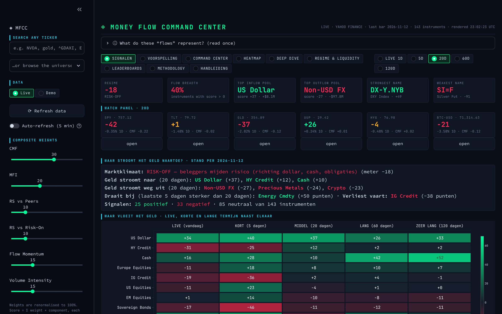
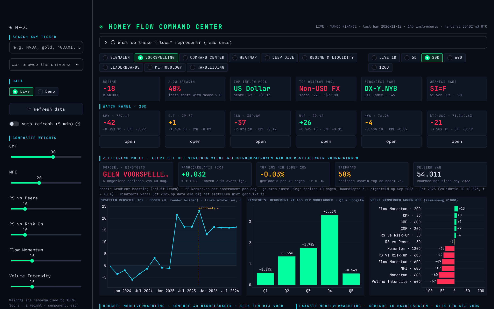
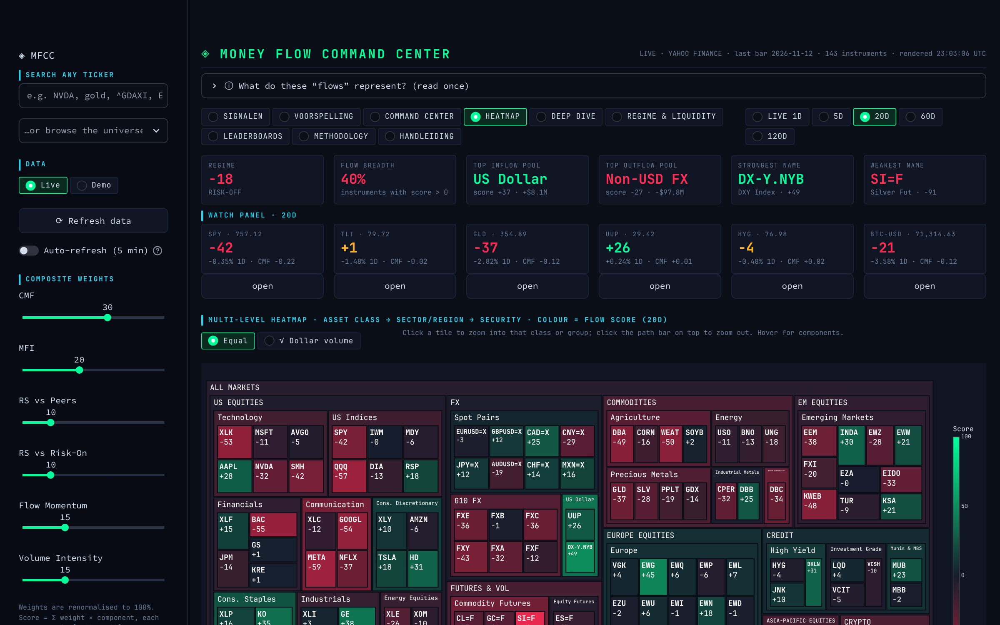
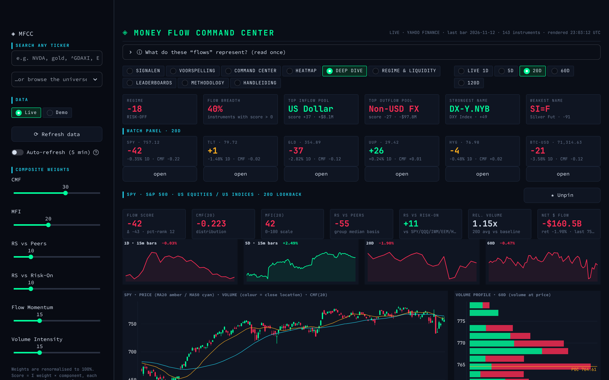

# Money Flow Command Center — Handleiding

Deze handleiding legt uit wat de app doet, hoe je hem start en hoe je elk scherm leest. Je hebt geen voorkennis van beleggingsjargon nodig; alle begrippen staan in hoofdstuk 5.

---

## 1. Wat is dit?

De Money Flow Command Center laat zien **waar geld naartoe stroomt en waar het vandaan komt** op de wereldmarkten: aandelen, obligaties, grondstoffen, valuta, futures en crypto. Hij volgt 143 instrumenten en rekent voor elk daarvan een **geldstroomscore** uit van −100 (er wordt zwaar verkocht) tot +100 (er wordt zwaar gekocht).

Drie dingen om vooraf te weten:

1. **Het zijn afgeleide stromen, geen gemeten stromen.** Echte cijfers over geldstromen zijn niet gratis beschikbaar. De app leidt koop- en verkoopdruk af uit koers en handelsvolume.
2. **De data komt van Yahoo Finance** en kan tot 15 minuten vertraagd zijn.
3. **De app geeft signalen, geen zekerheid.** Hij meet zelf hoe betrouwbaar zijn signalen in het verleden waren en toont dat eerlijk. Lees hoofdstuk 7 voordat je er geld op inzet.

---

## 2. Starten, stoppen en bijwerken

### Starten

- **Op de pc:** dubbelklik op het icoon **Money Flow** op je bureaublad of zoek "Money Flow" in het programmamenu. De app opent in een eigen venster, zonder adresbalk.
- **Op je telefoon** (zelfde wifi-netwerk): open in de browser `http://<ip-adres-van-de-pc>:8501`. Het adres staat in de laatste regel die de installer toonde. Zet het daarna op je beginscherm via *Deel → Zet op beginscherm*.

De eerste keer laden duurt 20 tot 40 seconden, omdat dan vijf jaar koersen worden opgehaald. Daarna wordt alles 15 minuten onthouden.

### Stoppen en herstarten

De app draait als achtergronddienst en start vanzelf mee met de pc. In een terminal:

| Wat | Commando |
|---|---|
| Status bekijken | `systemctl --user status money-flow` |
| Herstarten | `systemctl --user restart money-flow` |
| Stoppen | `systemctl --user stop money-flow` |
| Niet meer automatisch starten | `systemctl --user disable money-flow` |

Het venster sluiten stopt de dienst niet; de app blijft bereikbaar voor je telefoon.

### Bijwerken

Voer een nieuwere `install-money-flow.sh` opnieuw uit. Die overschrijft de oude versie en herstart de app. Gewichten en vastgepinde instrumenten staan daarna weer op de standaardwaarden.

---

## 3. De indeling van het scherm



**Zijbalk (links)**

- **Search any ticker** — typ een symbool (`NVDA`) of een naam (`gold`) en druk op Enter. Elk symbool dat Yahoo Finance kent werkt, ook buiten de 143 standaardinstrumenten, bijvoorbeeld `ASML.AS` of `^AEX`.
- **Live / Demo** — *Live* gebruikt echte koersen. *Demo* gebruikt verzonnen oefendata; er staat dan een oranje balk bovenaan.
- **Refresh data** — haalt alle koersen opnieuw op.
- **Auto-refresh (5 min)** — herlaadt de pagina elke vijf minuten.
- **Composite weights** — hoe zwaar elk onderdeel in de score meetelt. Laat dit staan tot je weet wat je doet.

**Bovenbalk**

- **Schermkeuze** — de negen schermen uit hoofdstuk 4.
- **Tijdsbalk** — over welke periode de stromen gemeten worden:

| Keuze | Betekenis | Gebruik |
|---|---|---|
| LIVE 1D | vandaag, op 15-minutenkoersen | wat gebeurt er nu |
| 5D | laatste 5 handelsdagen | korte termijn |
| 20D | laatste 20 handelsdagen (±1 maand) | middellange termijn, de standaard |
| 60D | laatste 60 handelsdagen (±3 maanden) | lange termijn |
| 120D | laatste 120 handelsdagen (±6 maanden) | zeer lange termijn |

**Kerncijfers (zes tegels)** — marktklimaat, het aandeel instrumenten met instroom, de sterkste en zwakste geldpool, en de sterkste en zwakste naam.

**Watch panel** — de instrumenten die je zelf hebt vastgepind. Klik *open* voor de detailpagina.

**Kleuren** — groen is instroom, rood is uitstroom, oranje is neutraal.

---

## 4. De schermen

### 4.1 SIGNALEN — begin hier

Het overzicht in gewone taal. Van boven naar beneden:

- **Samenvatting** — het marktklimaat, waar geld naartoe stroomt, waar het uit wegstroomt en wat aan het omslaan is.
- **Waar vloeit het geld** — een tabel met per geldpool de score voor live, kort, middel, lang en zeer lang. Een rij die overal groen is trekt op elke termijn geld aan. Groen links en rood rechts betekent een recente omslag naar instroom.
- **Sterkste instroom / uitstroom** — de ranglijsten. De kolommen:

| Kolom | Betekenis |
|---|---|
| Signaal | `STERK ▲`: alle drie de termijnen positief en totaal boven +35. `POSITIEF ▲`: alle drie positief, of totaal boven +25. `▼` is het spiegelbeeld. |
| Fase | *versnelt*: de korte termijn is sterker dan de middellange. *verzwakt*: het omgekeerde. *stabiel*: ongeveer gelijk. |
| Totaal | 30% × 5D + 40% × 20D + 30% × 60D |
| Live, 5D, 20D, 60D | de score per termijn |

- **Hoe betrouwbaar is dit signaal?** — een toets op het verleden: deden instrumenten met hoge scores het daarna ook beter? Zie hoofdstuk 7.

Klik op een rij om de detailpagina van dat instrument te openen.

### 4.2 VOORSPELLING — het zelflerende model



Een model dat uit vijf jaar historie leert welke geldstroompatronen aan koersstijgingen voorafgingen, en daarmee een verwachting voor de komende weken geeft.

- **Voorspellend? · eindtoets** — de belangrijkste tegel: *JA — AANTOONBAAR*, *ZWAK* of *NEE*. Hij zegt of het model op data die het nooit gezien heeft beter dan toeval rangschikte.
- **Rangcorrelatie (IC)** en **t** — hoe goed de voorspelde volgorde overeenkwam met de werkelijke. Een t boven 2 geldt als statistisch overtuigend.
- **Top 20% min bodem 20%** — hoeveel beter de hoogst gerangschikte instrumenten het deden dan de laagste.
- **Hoogste / laagste modelverwachting** — de actuele voorspelling. *Model* +100 betekent: verwacht bij de best presterende; −100: bij de slechtste. Het is een rangorde, geen koersdoel.
- **Zelf-afstelling** — alle instellingen die het model op zichzelf heeft uitgeprobeerd, met de gekozen instelling gemarkeerd.

Het model traint en stelt zichzelf opnieuw af bij elke verversing van de data, maximaal eens per uur. De eerste keer duurt dat ongeveer een minuut.

### 4.3 COMMAND CENTER

- **Sankey-diagram** — links de pools waar geld uit wegstroomt, rechts de pools waar het naartoe gaat. Hoe breder het lint, hoe sterker de stroom. Dit is een rekenmodel van de netto druk, geen waarneming van wie aan wie verkoopt.
- **Pool scores** — klik op een balk om in die pool te duiken; daaronder verschijnen de groepen en de afzonderlijke instrumenten.
- **Pool flow score history** — hoe de score van elke pool de afgelopen maanden verliep.

### 4.4 HEATMAP



Alle instrumenten in één beeld, ingedeeld naar beleggingscategorie → sector of regio → instrument. De kleur is de score. Klik op een vak om in te zoomen; klik op de balk bovenaan om terug te gaan. Daaronder staat een tabel die per groep de score op elke termijn toont.

### 4.5 DEEP DIVE — één instrument



- **Zeven tegels** — de score en zijn onderdelen voor dit instrument.
- **Vier grafiekjes** — het koersverloop over 1, 5, 20 en 60 dagen.
- **Koersgrafiek** — koers met twee gemiddelden, daaronder het volume en de geldstroomlijn (CMF).
- **Volume profile** — op welke koersniveaus het meest verhandeld is. *POC* is het niveau met het meeste volume.
- **Score decomposition** — welk onderdeel de score omhoog of omlaag trekt.
- **Group comparison** — dit instrument naast zijn soortgenoten.
- **Pin to watch** — zet het instrument in je watch panel.

### 4.6 REGIME & LIQUIDITY

- **Risk-on / risk-off meter** — zoeken beleggers risico op of mijden ze het? Gebaseerd op tien verhoudingen tussen markten, zoals aandelen tegenover obligaties en koper tegenover goud.
- **Liquidity proxy** — hoe ruim geld beschikbaar lijkt, afgeleid uit krediet, de dollar en volatiliteit.
- **Cross-asset confirmation** — de tien signalen afzonderlijk. Wijzen ze dezelfde kant op, dan is het beeld betrouwbaarder.
- **Central-bank liquidity** en **Futures positioning** — cijfers van de Amerikaanse centrale bank en van de toezichthouder op de termijnmarkten. Ze verschijnen alleen als die bronnen bereikbaar zijn.

### 4.7 LEADERBOARDS

Sorteerbare ranglijsten per instrument, sector of regio, beleggingscategorie en pool. Klik op een kolomkop om te sorteren. Met *Export CSV* sla je de lijst op voor Excel.

### 4.8 METHODOLOGY

De exacte formules, de huidige gewichten, de beperkingen en de volledige lijst van instrumenten.

### 4.9 HANDLEIDING

Deze handleiding, in de app zelf.

---

## 5. Begrippen

| Begrip | Uitleg |
|---|---|
| **Geldstroomscore** | Eén getal van −100 tot +100 dat zes metingen combineert. Boven 0: netto koopdruk. Onder 0: netto verkoopdruk. |
| **CMF** (Chaikin Money Flow) | Sluit de koers steeds bovenin zijn dagbereik bij hoog volume, dan wordt er gekocht. Loopt van −1 tot +1. |
| **MFI** (Money Flow Index) | Een maat van 0 tot 100 voor koopdruk. Boven 80 is veel gekocht, onder 20 veel verkocht. |
| **RS vs peers** | Doet dit instrument het beter of slechter dan zijn soortgenoten? |
| **RS vs risk-on** | Doet het het beter of slechter dan een mandje risicovolle beleggingen? |
| **Flow momentum** | Neemt de koopdruk toe of af? |
| **RVOL** (relatief volume) | Het handelsvolume ten opzichte van normaal. 1,5x betekent anderhalf keer zo druk als gewoonlijk. |
| **Net $ flow** | Een schatting in dollars van de netto koop- of verkoopdruk. |
| **Pool** | Een groep instrumenten die samen één geldbestemming vormen, zoals *US Equities* of *Precious Metals*. |
| **Risk-on / risk-off** | Risk-on: beleggers kopen risicovolle beleggingen. Risk-off: ze vluchten naar veilige havens. |
| **Ticker** | De korte code van een instrument, zoals `SPY` of `GLD`. |

---

## 6. Een werkwijze in vijf stappen

1. **SIGNALEN openen.** Lees de samenvatting: welk klimaat, welke pools trekken geld aan.
2. **De termijnentabel bekijken.** Zoek pools die op meerdere termijnen groen zijn. Dat is breed gedragen instroom.
3. **In de ranglijst een kandidaat kiezen.** Let op `STERK ▲` met fase *versnelt* of *stabiel*.
4. **De detailpagina openen.** Controleer of de score door meerdere onderdelen wordt gedragen en of het instrument sterker is dan zijn groep.
5. **Het oordeel in VOORSPELLING lezen.** Staat daar geen aantoonbare voorspellende waarde, behandel het signaal dan als een aanwijzing om verder te onderzoeken en niet als een koopopdracht.

---

## 7. Betrouwbaarheid en grenzen

De app toetst zichzelf op twee plaatsen, en je hoort beide uitkomsten te kennen.

**De toets in SIGNALEN** deelt de instrumenten in vijf groepen naar score en meet wat ze in de dagen daarna werkelijk deden. Het oordeel staat ernaast.

**De eindtoets in VOORSPELLING** werkt in drie stappen:

1. Het model wordt telkens alleen op het verleden getraind en voorspelt daarna de periode erna.
2. Het probeert verschillende instellingen uit en kiest de beste op een **validatieperiode**.
3. Het oordeel komt uit een latere **eindtoetsperiode** die bij het kiezen niet is gebruikt.

Stap 3 is bewust zo streng. Een model dat mag blijven sleutelen tot dezelfde testdata er goed uitziet, vindt altijd iets dat overtuigend lijkt, ook in puur toeval. Zo'n model faalt met echt geld. Daarom kan de app eerlijk uitkomen op *zwak* of *geen voorspellende waarde*; dat is dan de werkelijke stand, geen fout.

Wat de app niet kan:

- **Geen zekerheid per aandeel.** Zelfs een aantoonbaar voorspellend model heeft een kleine voorsprong over veel posities, niet gelijk bij elke keuze.
- **Geen nieuws.** Bedrijfsresultaten, rentebesluiten en politiek ziet hij pas terug in de koers.
- **Geen kosten.** De toetsen rekenen zonder transactiekosten en belasting.
- **Geen advies op maat.** De app kent je vermogen, je doelen en je risico niet.

---

## 8. Problemen oplossen

| Probleem | Oplossing |
|---|---|
| Oranje balk "live data unreachable" | Geen verbinding met Yahoo. Controleer het internet en klik *Refresh data*. Blijft het zo, werk dan bij met `~/money-flow-command-center/.venv/bin/pip install -U yfinance` en herstart. |
| Het venster blijft leeg of laadt niet | Herstart de dienst: `systemctl --user restart money-flow`. Wacht 10 seconden en open opnieuw. |
| Telefoon krijgt geen verbinding | Controleer of de telefoon op hetzelfde wifi-netwerk zit. Zet de poort open: `sudo ufw allow 8501/tcp`. |
| LIVE 1D geeft een oranje balk | Yahoo gaf geen 15-minutenkoersen; de app toont dan 5D. Probeer het later opnieuw. |
| Een ticker wordt niet gevonden | Gebruik de schrijfwijze van Yahoo Finance: `ASML.AS`, `BMW.DE`, `^AEX`, `EURUSD=X`, `BTC-USD`. |
| VOORSPELLING duurt lang | De eerste keer traint het model ongeveer een minuut. Daarna wordt het resultaat een uur onthouden. |
| Foutmeldingen bekijken | `journalctl --user -u money-flow -n 50` |

---

## 9. Zelf instrumenten toevoegen

Open `~/money-flow-command-center/app.py` in een teksteditor. Bovenaan staat de lijst `U`. Voeg een regel toe in dezelfde vorm:

```python
("ASML.AS", "ASML", "Europe Equities", "Europe"),
```

De vier velden zijn: ticker, naam, beleggingscategorie en groep. Sla op en herstart met `systemctl --user restart money-flow`. Bij een volgende update via de installer wordt `app.py` overschreven; bewaar je eigen regels dus apart.

---

*Deze app is een hulpmiddel voor analyse en geen beleggingsadvies. Beleggen brengt het risico van verlies met zich mee.*
